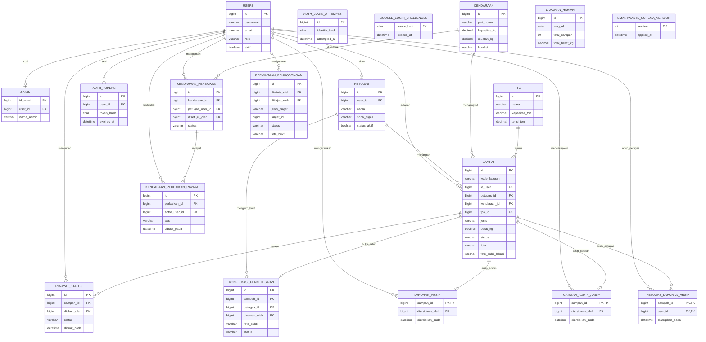

# ERD database Smart Waste

Database MySQL `smart_waste` adalah sumber data bersama untuk web warga dan aplikasi Android. Keduanya menggunakan REST API PHP yang sama.

## Kelompok tabel

| Kelompok | Tabel | Kegunaan |
|---|---|---|
| Akun dan sesi | `users`, `admin`, `petugas`, `auth_tokens` | Identitas, peran, profil, dan sesi aplikasi |
| Keamanan login | `auth_login_attempts`, `google_login_challenges` | Pembatasan percobaan masuk dan challenge autentikasi |
| Laporan warga | `sampah`, `riwayat_status`, `konfirmasi_penyelesaian` | Laporan awal, perubahan status, serta bukti akhir petugas |
| Arsip laporan | `laporan_arsip`, `catatan_admin_arsip`, `petugas_laporan_arsip` | Arsip admin, catatan, dan tampilan arsip petugas |
| Armada | `kendaraan`, `kendaraan_perbaikan`, `kendaraan_perbaikan_riwayat` | Kapasitas kendaraan dan alur perbaikan |
| TPA | `tpa`, `permintaan_pengosongan` | Kapasitas TPA dan persetujuan pengosongan |
| Rekap dan versi | `laporan_harian`, `smartwaste_schema_version` | Rekap harian dan versi migrasi skema |

Relasi pada diagram dan phpMyAdmin Designer adalah referensi logis aplikasi. Tabel saat ini belum memakai constraint foreign key fisik; ini menjaga alur arsip dan penghapusan permanen yang sudah diatur API. `permintaan_pengosongan.target_id` bersifat polimorfik: pasangan `jenis_target` menentukan apakah ID mengarah ke `kendaraan.id` atau `tpa.id`.

Foto tidak disimpan sebagai BLOB di MySQL. Berkas berada di `backend-php/uploads/`, sedangkan path-nya disimpan di kolom `foto`/ `foto_bukti`; folder unggahan harus ikut disalin saat memindahkan website.
